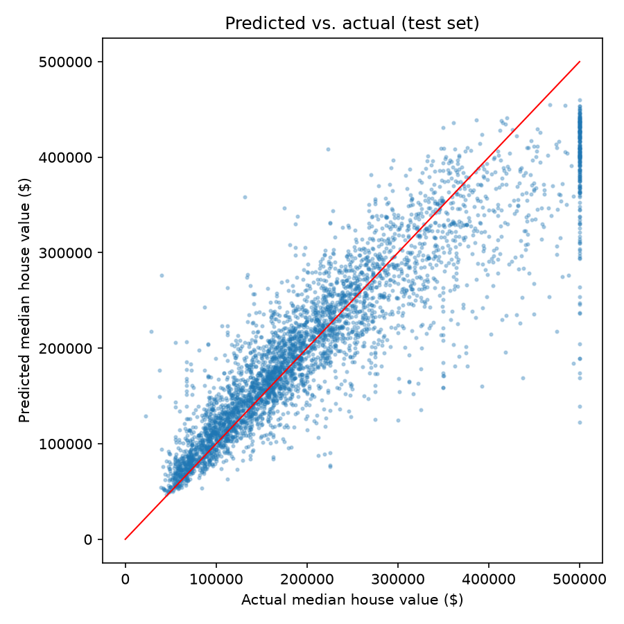
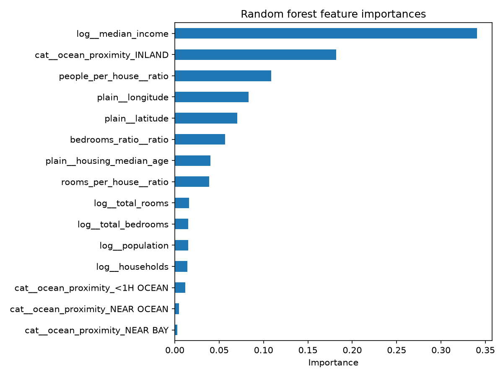

# California Housing Price Predictor

An end-to-end machine learning pipeline, written as plain Python modules, that predicts the median house value of California census districts. It covers data loading, a stratified train/test split, feature engineering, model comparison, hyperparameter tuning, a single final evaluation on a held-out test set, and a command-line prediction tool.

The project follows the California housing exercise from Chapter 2 of _Hands-On Machine Learning with Scikit-Learn, Keras & TensorFlow_ by Aurélien Géron, rebuilt as a reproducible script-based project instead of a notebook.

## Results

The final model is a tuned random forest. It scores a **test RMSE of $44,696** on districts with uncapped prices, and **$51,712** (95% CI: $49,409 to $53,917) on the full test set. The full test set includes 201 districts whose prices are capped at $500,001 in the data (see [Handling capped prices](#handling-capped-prices)).

Model comparison, using 10-fold cross-validation on the training set (the tuned model used 5-fold):

| Model                 | Train RMSE | CV RMSE | Notes                                                  |
| --------------------- | ---------- | ------- | ------------------------------------------------------ |
| Linear regression     | $62,093    | $62,938 | Underfits: train and CV errors match and are both high |
| Decision tree         | $0         | $64,384 | Heavily overfits: memorizes the training data          |
| Random forest         | $16,875    | $45,466 | Best untuned model                                     |
| Random forest (tuned) | n/a        | $44,995 | `RandomizedSearchCV`, 20 candidates, 5-fold            |

Tuning gave a small improvement over the default forest, which is within the noise between 5-fold and 10-fold estimates, so the main gain came from switching from a single model to an ensemble.

### Figures

Predicted vs. actual prices on the test set:



Feature importances of the tuned random forest:



Median income and the `INLAND` location category are the strongest predictors. Several engineered ratio features (people per household, bedrooms per room, rooms per household) rank among the top eight inputs. Importance shows what the model relies on, not how much each feature improved the score, and correlated features share credit.

## Dataset

The 1990 California census housing data, downloaded automatically on first run from the dataset repository that accompanies the book. It has 20,640 districts and 9 input features:

- Location: `longitude`, `latitude`, `ocean_proximity` (categorical)
- District makeup: `housing_median_age`, `total_rooms`, `total_bedrooms`, `population`, `households`, `median_income`
- Target: `median_house_value`

`total_bedrooms` is missing for 207 districts.

## Setup

Requires Python 3.10 or newer. Developed on Python 3.14.

```powershell
git clone https://github.com/<your-username>/california-housing-price-predictor.git
cd california-housing-price-predictor

py -m venv .venv
.\.venv\Scripts\activate
python -m pip install -r requirements.txt
```

On macOS or Linux:

```bash
python3 -m venv .venv
source .venv/bin/activate
python -m pip install -r requirements.txt
```

Dependency versions are pinned in `requirements.txt`.

## Usage

Run the steps in order from the repository root:

```
python -m src.data       # download the data and print a summary
python -m src.train      # compare linear regression, decision tree, random forest
python -m src.tune       # tune the random forest with randomized search
python -m src.evaluate   # one-time test set evaluation, figures
python -m src.predict    # predict prices with the saved model
```

`src.predict` with no arguments predicts five districts from the test set as a demo. To predict your own data, pass a CSV with the same raw columns as the original dataset:

```
python -m src.predict my_districts.csv --output predictions.csv
```

The saved model is a full scikit-learn pipeline, so the CSV needs only raw values. Imputation, log transforms, ratio features, scaling, and encoding all happen inside the model.

## Project structure

```
california-housing-price-predictor/
├── README.md
├── requirements.txt
├── .gitignore
├── src/
│   ├── data.py        # download, load, stratified train/test split
│   ├── features.py    # preprocessing pipeline and feature engineering
│   ├── train.py       # compare models with cross-validation
│   ├── tune.py        # randomized hyperparameter search
│   ├── evaluate.py    # test set metrics and figures
│   └── predict.py     # command-line prediction
├── reports/
│   ├── figures/       # generated plots
│   └── tuning_results.csv
├── data/              # downloaded dataset (not tracked)
└── models/            # saved models (not tracked)
```

## Approach

**Split.** The data is split 80/20 with a fixed random seed, stratified by income category. Median income is a strong predictor, so stratifying keeps the income distribution the same in both sets. The test set is not touched until the final evaluation.

**Preprocessing.** Everything is built into one scikit-learn pipeline that is fitted on training data only, so no statistics leak from the test set or between cross-validation folds:

- Median imputation for missing values
- Ratio features: bedrooms per room, rooms per household, people per household
- Log transform for heavy-tailed columns (rooms, bedrooms, population, households, income)
- Standard scaling for numeric features
- One-hot encoding for `ocean_proximity`

**Model selection.** Linear regression, a decision tree, and a random forest are compared with the same cross-validation. The random forest is then tuned over `n_estimators`, `max_features`, `max_depth`, and `min_samples_leaf`. Best parameters found: `n_estimators=231`, `max_features=8`, `max_depth=None`, `min_samples_leaf=2`.

**Evaluation.** The tuned model is scored once on the test set. The test set was not used for any modeling decision.

### Handling capped prices

In this dataset, any district with a median house value above $500,000 is recorded as $500,001, so the true price is unknown. Those rows are dropped from the **training** data so the model is not taught wrong labels. The **test** set keeps them, since they exist in real data, which has two consequences:

- The model underpredicts the most expensive districts, which shows up as a horizontal band of capped points in the predicted-vs-actual plot.
- Two test RMSEs are reported: one on all districts ($51,712) and one excluding the 201 capped districts ($44,696). The second is the like-for-like comparison with the cross-validation scores, which were computed on training data without capped rows.

## Limitations and next steps

- The data is from the 1990 census, so the model reflects prices and demographics from then, not current ones.
- The model underpredicts above $500,000 because it never saw those prices.
- Possible improvements: a geographic cluster-similarity feature (k-means on latitude and longitude), gradient boosting (`HistGradientBoostingRegressor`), and unit tests for the feature pipeline.
